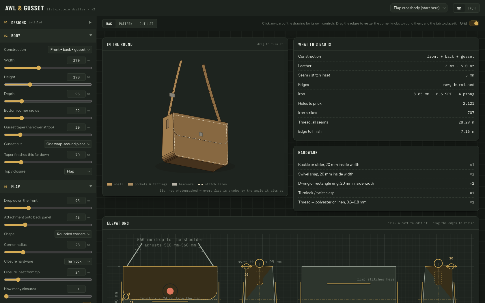

# Awl & Gusset

A parametric flat-pattern drafter for hand-sewn leather bags. Set the dimensions, get the cut
pieces, the stitch-hole plan, the hardware list and the order it goes together in.

**[Open the drafter →](https://jkw2lo.github.io/awl-gusset/)**



It is one static page. No build step, no dependencies, no server — clone it and open
`index.html`, or use the link above.

## What it does

- **Six constructions.** Front + back + gusset, one-piece boxed corners, a round-based bucket,
  a barrel, a folded clutch, and *a shape you draw yourself*.
- **Sixteen element types** — pockets, tabs, keepers, loops, handles, feet, stamps — placeable
  on any of six faces, each turnable, each bringing its own cut piece and stitch box.
- **A stitch plan you can prick.** Every seam is fitted to a whole number of holes, and the two
  pieces that meet are given the *same* count, so a gusset cannot creep against its panel.
- **Six orthographic views, a lit 3D model, and the inside laid open** — the walls unrolled, so
  the interior can be designed against something other than a pattern sheet.
- **Paper.** Tiled sheets at 1:1 with alignment crosses and a printed ruler, hand-arrangeable,
  and a vector PDF written from scratch.

## How a bag becomes a pattern

The whole tool is one pipeline, and it only runs one way:

```
  S  ─────────►  draft()  ─────────►  pieces  ─────────►  renderers
the design       the engine          cut shapes,          sheets, PDF, 3D,
(one object)                         seams, holes         elevations, cut list
```

`S` is the entire design — dimensions, construction, elements, allowances, stitch settings —
and it is the only thing that is ever edited. `draft()` turns it into pieces. Every renderer is
a *reader* of those pieces; none of them writes back. A `.bag.json` design file is just `S`,
saved.

The one idea that holds it together is the **seam registry**: a seam is planned once to a hole
count, and every piece carrying that seam's key reads the same number off the plan. That is why
two pieces that get sewn together always have the same number of holes in them.

## Where the code lives

Every file in `src/` is a plain script sharing one global scope. There is no bundler and
nothing is imported — `index.html` lists them in dependency order, and that list is the only
place the order is written down.

| File | What it owns |
|---|---|
| `save-file.js` | Handing the reader a file |
| `free-shape.js` | The drawn profile |
| `model.js` | `S`, the presets, units, and the control schema |
| `geometry.js` | Path helpers, all in millimetres |
| `seams.js` | The seam registry and stitch holes |
| `engine.js` | The shell constructions |
| `elements.js` | Everything you add to a bag |
| `draft.js` | `draft()` — the whole pattern, in one pass |
| `render-sheets.js` | The pattern on paper |
| `render-inside.js` | The walls unrolled |
| `shape-editor.js` | Dragging the profile about |
| `render-elevation.js` | The six views, and dragging features onto them |
| `render-3d.js` | The lit model |
| `render-cutlist.js` | Cut list, build order, and the stitch-fit advice |
| `pdf.js` | The PDF writer |
| `designs.js` | Saving, opening and sanitising a design |
| `picker.js`, `inspector.js` | The menu and the floating control panel |
| `wiring.js` | The control rail and every event handler |

Styles are in `src/styles/`: `base.css` (the page frame), `app.css` (the drafter) and
`sheet.css` (the pattern card, which is deliberately the same colour in light and dark — it is
paper).

## Making a change

```bash
npm test          # or: node tests/check.js
```

Then serve it and look:

```bash
python3 -m http.server 8731
```

Three things worth knowing before the first edit:

1. **Load order is real.** A file may *call* anything from anywhere, but at load time it may
   only touch what an earlier file already defined. Add a file to `src/`, then add its
   `<script src>` line to `index.html` in the right place. The `LOAD ORDER` section of the test
   suite is what catches this.
2. **[`CLAUDE.md`](CLAUDE.md) is the rulebook.** It lists the invariants that must not break and
   what each one cost to learn — a stitch box that started inside a fold, an 84 mm mismatch
   between a panel and its blank, rivets drawn off the leather. Read it before changing the
   engine.
3. **The tests are the safety net, and they are quick.** 4.5 million assertions in under a
   minute, over the same files the page loads.

## The tests

`tests/check.js` reads the load order out of `index.html`, takes everything above the first
line that touches the DOM, and runs it in node — so it exercises the files the site actually
serves rather than a copy.

It asserts *properties*, not snapshots: mating runs agree, no hole sits on a cut edge, no two
rows of holes coincide, no two labels overlap, nothing is left off the paper. Each of those
found a class of bug, repeatedly, without anyone having to know the right answer in advance.
Beyond the seven presets it sweeps 2,200+ combinations of construction, gusset cut, top, carry,
zip style, end shape and more, plus every element type on every face it offers — because
presets only cover the combinations the presets happen to use, and that is not where the bugs
were.

## Design files

A design is the whole spec in one small `.json` — the bag, not the drawing. Open it in the
drafter and the pattern, cut list and stitch plan are redrawn from it.

`designs/` holds the seven starting points, which are also built into the drafter:

| | |
|---|---|
| `flap-crossbody-start-here` | 270 × 190 × 95, wrap gusset, turnlock flap, adjustable strap |
| `boxed-corner-tote` | 330 × 300 × 130, one-piece boxed corners, turned edges, top handles |
| `zip-pouch` | 210 × 130 × 60, boxed, #3 zip straight to the rim |
| `bifold-wallet` | one blank creased down the middle, card slots one side, notes the other |
| `crescent-moon-bag` | a drawn profile, 300 × 210 × 70 — the shape editor with something in it |
| `day-pack` | 290 × 390 × 150, wrap gusset, strap-closed flap, padded shaped pack straps |
| `weekender-duffle` | 520 × 280 × 280, barrel, #8 zip along the top seam, top handles |

**Save** keeps a design in this browser; **Save file…** hands you a `.bag.json` to keep in a
folder of your own. Copy one and edit the copy rather than working on the original.

## Printing

**Pattern PDF** writes every sheet at 1:1, one page each. **Info pack PDF** is the one to keep:
what the bag is, every piece with the formula that produced it, the stitch counts, the build
order, and the whole pattern on one page so it can be read without taping anything up.

Print at **100% with fit-to-page OFF**, then measure the 100 mm ruler on the paper before
cutting anything. "Fit to page" rescales silently, and a pattern that is 3% small is a bag that
does not close. Where a piece spans more than one page, trim each to the dashed line and butt
the next against it; the alignment crosses and the part number say which goes where.

## Not built yet

Carried forward honestly from [the rebuild brief](docs/rebuild-brief.html), which is the fullest
account of what this tool knows about leather:

- Curved and shaped gussets — only a straight taper today.
- A flared bucket. A flared tube is a cone, and a cone unrolls to an annular sector, not a
  rectangle.
- A curved zip set into a front panel.
- Nesting pieces on a hide outline. The sheets pack to paper, not to leather.

## Licence

MIT — see [LICENSE](LICENSE).
